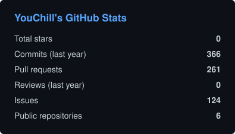
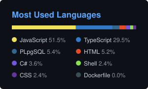

# Hi, I'm Paweł 👋

**End-to-end project builder** — from analysis and documentation to task management and deployment, powered by AI agents.

Currently building real-world projects **4fun** and for personal growth — mostly small, privacy-minded apps for family, school and everyday life.

---

### Projects

| Project | What it is | Stack |
|---|---|---|
| **Składkomat** _(private)_ | PWA for managing class fees: treasurer passkeys, parent login with e-mail codes, bank statement import that never leaves the browser, encrypted fields, hash-chained audit log, RLS | React + Vite, Hono, Better Auth, Neon, Drizzle, Vercel |
| **bar-budget-dashboard** _(private)_ | Budget tracker for bar events with no backend — data stays in a local folder (File System Access API), encrypted backup archives | React + Vite, Recharts, Vitest |
| [**budget-app**](https://github.com/YouChill/budget-app) | Shared household budget: transactions, budgets, yearly summary, offline mode, REST API, AI-assisted CSV import | React 19, Tailwind 4, Supabase, pgvector, OpenAI |
| [**train-stack**](https://github.com/YouChill/train-stack) | Weekly training planner with workout log, stats, reports, AI plan generator, Garmin import and Web Push reminders | React + Vite, Vercel serverless, PostgreSQL |
| [**cartlo**](https://github.com/YouChill/cartlo) | Family shopping list PWA with real-time sync and semantic product categorisation | Next.js 16, Neon + pgvector, Drizzle, NextAuth, Pusher |
| [**getmonolith**](https://github.com/YouChill/getmonolith) | Notion-style tasks and notes — every Kanban card is also an editable page | Next.js 16, Supabase, Drizzle, BlockNote, TanStack Query |
| [**kanban-dev**](https://github.com/YouChill/kanban-dev) | Kanban boards in Blazor Server | .NET 8, MudBlazor, SQLite / PostgreSQL, Docker |
| **li-obsidian** _(private)_ | Obsidian vault versioned in Git, with commit conventions and a session workflow for writing and content planning | Obsidian, Markdown, Git |

---

### Tech Stack

### Data & Infrastructure

### Testing

### AI & Automation

### What I Do

- Deliver full project lifecycles — analysis, docs, ADRs, implementation, deployment
- Leverage AI agents to accelerate development workflows — from issues to reviewed, CI-green PRs
- Build modern web apps and PWAs with privacy and security designed in from day one
- Use AI where it helps the user — semantic categorisation, CSV import, plan generation

---

### GitHub Stats

Public repositories only; cards refresh daily via GitHub Actions.

---

### Contact

